# SKILLTRACK

**Employee Learning, Skill Development and Compliance Management Platform**

Backend REST API — Phase 22: Production Readiness

---

## Overview

SKILLTRACK is an enterprise-grade platform designed for managing employee learning, skill development, and compliance tracking.

This repository contains the backend implementation through **Phase 20 (Security Hardening)**. Building upon Phases 1 through 19, Phase 20 hardens the entire backend surface against OWASP Top 10 vulnerabilities, unauthorized access, and sensitive data leakage:

- **Authentication & JWT Hardening:**
  - Strict enforcement of `HS256` symmetric signing and verification algorithms in `jsonwebtoken`.
  - Rejection of algorithm confusion attacks (`none`, `RS256`, and asymmetric algorithms).
  - Strict verification of token signature, expiration (`exp`), and structural validity.
  - Rejection of empty/missing/malformed tokens and tokens without minimal identity claims (`userId`, `role`).
  - Safe payload containment: Tokens carry minimal claims and never contain sensitive credentials.
- **Password Security:**
  - Password hashing via `bcryptjs` with configurable $\ge 10$ salt rounds.
  - Password hashes are completely excluded from schema defaults (`select: false`), API responses, and logs.
  - Client injection resistance: Client cannot supply pre-computed `passwordHash` or bypass bcrypt hashing.
- **Authorization & RBAC Fail-Closed:**
  - Server-authoritative role verification directly against database records.
  - Fail-closed security posture: Unknown or tampered roles in tokens are denied access (`403 Forbidden`).
  - Protection against privilege escalation and Insecure Direct Object References (IDOR).
- **NoSQL Injection & Prototype Pollution Defense:**
  - Centralized recursive inspection (`noSqlInjectionGuard`) of untrusted request inputs (`req.query`, `req.body`, `req.params`).
  - Rejection of MongoDB operator keys starting with `$` (`$gt`, `$ne`, `$where`, `$regex`).
  - Rejection of MongoDB dot-path notation keys (`user.role`, deep nested paths).
  - Rejection of prototype pollution keys (`__proto__`, `constructor`, `prototype`).
  - Rejection with clean `400 Bad Request` while allowing legitimate string values containing `$` or `.`.
- **HTTP Security Headers & Request Correlation:**
  - Comprehensive HTTP security headers via `helmet`:
    - `X-Content-Type-Options: nosniff`
    - `X-Frame-Options: SAMEORIGIN`
    - `Referrer-Policy: no-referrer`
    - `Strict-Transport-Security` (HSTS enabled in production mode)
  - Information leakage prevention: `X-Powered-By: Express` disabled.
  - Request correlation tracking: Cryptographically random `X-Request-Id` attached to every request and response.
- **CORS Hardening:**
  - Restricts cross-origin resource sharing to explicitly allowlisted origins defined in `CORS_ORIGIN`.
  - Disallowed origins rejected with `403 Forbidden` or header omission; untrusted origins are never reflected.
  - Credential sharing is prohibited when wildcard origins are configured.
  - Public `/api/health` probes remain accessible for platform monitoring.
- **Rate Limiting:**
  - Sensitive authentication endpoints (`/api/auth/register`, `/api/auth/login`) protected by `authLimiter`.
  - General API endpoints protected by `apiLimiter`.
  - Graceful throttling with standard headers and standardized `429 Too Many Requests` JSON response.
- **Request Body Size Limits:**
  - Express JSON and URL-encoded parsers constrained to configurable `BODY_LIMIT` (default `10kb`).
  - Oversized payloads rejected with `413 Payload Too Large`.
- **Error Information Leakage Prevention:**
  - MongoDB `CastError` (e.g., malformed ObjectIds) cleanly transformed to `400 Bad Request` (`Invalid identifier`).
  - Production error masking: 500 errors masked to `"Internal Server Error"`.
  - Stack traces, local file paths, and database connection URIs scrubbed from client responses in production.
- **Secure Configuration & Environment Validation:**
  - Strict startup validation: Production mode enforces non-placeholder `JWT_SECRET` ($\ge 8$ chars) and rejects wildcard CORS.

> [!IMPORTANT]
> **Phase 20 Scope & Strict Boundaries:**
> This phase establishes comprehensive server-side security hardening.
> **Strictly NO frontend/UI changes, NO external infrastructure (Redis/WAF), NO AI/ML, and NO unnecessary package bloat.**

---

## Backend Technology Stack

- **Runtime:** Node.js (v24+)
- **Framework:** Express.js (v4)
- **Database Layer:** MongoDB + Mongoose (v9)
- **Authentication & Security:** JSON Web Tokens (`jsonwebtoken`), `bcryptjs`
- **Language:** JavaScript (CommonJS)
- **Configuration:** Dotenv (centralized loader and validator)
- **Testing:** Jest, Supertest
- **Development Tooling:** Nodemon, CORS

---

## Project Structure

```text
server/
│
├── src/
│   ├── config/
│   │   ├── database.js               # MongoDB connection, lifecycle events, and graceful shutdown
│   │   └── index.js                  # Centralized environment configuration and validation
│   ├── controllers/
│   │   ├── analytics.controller.js   # [NEW] Analytics reporting endpoints controller
│   │   ├── assessment.controller.js  # Assessment CRUD, publish, archive, attempt-data
│   │   ├── assessmentAttempt.controller.js # Attempt start, submit, and getById controller
│   │   ├── assessmentResult.controller.js  # Result retrieval, employee history, performance
│   │   ├── auth.controller.js        # Authentication controller (register, login, me)
│   │   ├── certificate.controller.js # Certificate issuance, verification, revocation, renewal
│   │   ├── compliance.controller.js  # [NEW] Compliance requirements, assignments, summaries & refresh
│   │   ├── course.controller.js      # Course CRUD controller
│   │   ├── courseRecommendation.controller.js # Employee & Admin course recommendation controller
│   │   ├── courseSkill.controller.js # Course skill mapping management controller
│   │   ├── department.controller.js  # Department CRUD controller
│   │   ├── employee.controller.js    # Employee CRUD & self-profile controller
│   │   ├── employeeSkill.controller.js # Employee skill assignment & self-listing
│   │   ├── enrollment.controller.js  # Enrollment CRUD & progress controller
│   │   ├── health.controller.js      # Health check route controller
│   │   ├── jobRole.controller.js     # Job Role CRUD & requirement listing controller
│   │   ├── jobRoleSkillRequirement.controller.js # Requirement CRUD controller
│   │   ├── lesson.controller.js      # Lesson CRUD controller
│   │   ├── module.controller.js      # Module CRUD controller
│   │   ├── notification.controller.js # Notification inbox, read, count, soft delete
│   │   ├── question.controller.js    # Question CRUD & security projection controller
│   │   ├── skill.controller.js       # Skill CRUD controller
│   │   └── skillGapAnalysis.controller.js # Employee & Admin skill gap analysis controller
│   ├── middleware/
│   │   ├── authMiddleware.js         # Authentication: verifies JWT and resolves user
│   │   ├── errorHandler.js           # Centralized JSON error handling middleware
│   │   ├── notFoundHandler.js        # 404 catch-all route middleware
│   │   ├── rateLimiter.js            # [NEW] Rate limiters (authLimiter, apiLimiter)
│   │   ├── roleMiddleware.js         # Authorization: role-based access control (RBAC)
│   │   └── security.middleware.js    # [NEW] NoSQL injection & prototype pollution guard, correlation ID
│   ├── models/
│   │   ├── Assessment.js             # Assessment model with course/module/trainer refs
│   │   ├── AssessmentAttempt.js      # Attempt model with evaluated result fields & indexes
│   │   ├── Certificate.js            # Certificate model with expiry, renewedFrom & indexes
│   │   ├── ComplianceAssignment.js   # [NEW] ComplianceAssignment model with compound unique index
│   │   ├── ComplianceRequirement.js  # [NEW] ComplianceRequirement model with frequency & constraints
│   │   ├── Course.js                 # Course model with category/level/status indexes
│   │   ├── CourseSkill.js            # CourseSkill model with compound unique index
│   │   ├── Department.js             # Department model with case-insensitive unique name
│   │   ├── Employee.js               # Employee model linking User and Department
│   │   ├── EmployeeSkill.js          # EmployeeSkill model with compound unique index
│   │   ├── Enrollment.js             # Enrollment model with compound unique index
│   │   ├── JobRole.js                # Job Role model with case-insensitive name & unique code
│   │   ├── JobRoleSkillRequirement.js # Requirement model with compound unique index
│   │   ├── Lesson.js                 # Lesson model with content types, URL rules, order index
│   │   ├── Module.js                 # Module model with course ref, order index
│   │   ├── Notification.js           # Notification model with eventKey unique index
│   │   ├── Question.js               # Question model with option keys and correctAnswers
│   │   ├── Skill.js                  # Skill model with case-insensitive unique name & proficiency levels
│   │   └── User.js                   # User Mongoose model with bcrypt pre-save hook
│   ├── routes/
│   │   ├── analytics.routes.js       # [NEW] Analytics reporting routes (/api/analytics)
│   │   ├── assessment.routes.js      # Assessment, Question, Attempt, Result routes
│   │   ├── auth.routes.js            # Authentication routes (/api/auth)
│   │   ├── certificate.routes.js     # Certificate routes (/api/certificates)
│   │   ├── compliance.routes.js      # Compliance assignments, summaries & refresh (/api/compliance)
│   │   ├── complianceRequirement.routes.js # Admin requirement CRUD & assignments (/api/compliance-requirements)
│   │   ├── course.routes.js          # Course & Course-Skill routes (/api/courses)
│   │   ├── courseSkill.routes.js     # Direct course-skill routes (/api/course-skills)
│   │   ├── department.routes.js      # Department routes (/api/departments)
│   │   ├── employee.routes.js        # Employee, Compliance, Skill Gap & Recommendation routes (/api/employees)
│   │   ├── employeeSkill.routes.js   # Direct employee-skill routes (/api/employee-skills)
│   │   ├── enrollment.routes.js      # Enrollment routes (/api/enrollments)
│   │   ├── health.routes.js          # Health route declarations (/api/health)
│   │   ├── index.js                  # Base /api router combining all domain routes
│   │   ├── jobRole.routes.js         # Job Role routes (/api/job-roles)
│   │   ├── jobRoleSkillRequirement.routes.js # Requirement routes (/api/job-role-requirements)
│   │   ├── lesson.routes.js          # Lesson routes (/api/lessons)
│   │   ├── module.routes.js          # Module routes (/api/modules)
│   │   ├── notification.routes.js    # Notification routes (/api/notifications)
│   │   ├── rbac.routes.js            # RBAC demonstration & verification routes (/api/rbac)
│   │   └── skill.routes.js           # Skill routes (/api/skills)
│   ├── services/
│   │   ├── analytics.service.js      # [NEW] Aggregation pipelines & deterministic reporting
│   │   ├── assessment.service.js     # Assessment CRUD, ownership, attempt-data generator
│   │   ├── assessmentAttempt.service.js # Attempt start, submission & instant evaluation
│   │   ├── assessmentResult.service.js  # Scoring engine, history, and performance analytics
│   │   ├── auth.service.js           # Registration, login, and JWT token issuance
│   │   ├── certificate.service.js    # Certificate eligibility, issuance, renewal, expiry
│   │   ├── compliance.service.js     # Compliance CRUD, assignments, status evaluation & summaries
│   │   ├── course.service.js         # Course business logic, trainer ownership, visibility
│   │   ├── courseRecommendation.service.js # Deterministic recommendation scoring & candidate retrieval
│   │   ├── courseSkill.service.js    # Course-to-skill mapping CRUD and validations
│   │   ├── department.service.js     # Department business logic, uniqueness checks, soft deletion
│   │   ├── employee.service.js       # Employee business logic, relations, and self-profile
│   │   ├── employeeSkill.service.js  # Employee skill assignment, queries, soft deletion
│   │   ├── enrollment.service.js     # Enrollment, progress calculation, completion logic
│   │   ├── jobRole.service.js        # Job Role business logic & code normalization
│   │   ├── jobRoleSkillRequirement.service.js # Requirement business logic & validation
│   │   ├── lesson.service.js         # Lesson business logic, trainer check via parent course
│   │   ├── module.service.js         # Module business logic, trainer ownership, order validation
│   │   ├── notification.service.js   # In-app notification creation, queries, scanning
│   │   ├── question.service.js       # Question CRUD, order conflict prevention, projection
│   │   ├── skill.service.js          # Skill business logic & case-insensitive uniqueness
│   │   └── skillGapAnalysis.service.js # Deterministic skill gap comparison & summary calculation
│   ├── utils/
│   │   ├── AppError.js               # Custom operational error class
│   │   ├── proficiency.js            # Centralized proficiency ranking & comparison
│   │   └── response.js               # Standardized response helper utilities
│   ├── validators/
│   │   ├── analytics.validator.js    # [NEW] Date normalization, ObjectId & query validator
│   │   ├── assessment.validator.js   # Rejection of client-injected result fields
│   │   ├── assessmentResult.validator.js # Validation helpers for results
│   │   ├── auth.validator.js         # Registration and login payload validators
│   │   ├── certificate.validator.js  # Certificate anti-injection & query validators
│   │   ├── compliance.validator.js   # [NEW] Compliance requirement, assignment & query validators
│   │   ├── course.validator.js       # Course payload validator
│   │   ├── courseRecommendation.validator.js # Recommendation params & query validators
│   │   ├── courseSkill.validator.js  # Course skill payload & query validators
│   │   ├── department.validator.js   # Department payload validator
│   │   ├── employee.validator.js     # Employee payload validator
│   │   ├── employeeSkill.validator.js # Employee skill payload & anti-injection validators
│   │   ├── enrollment.validator.js   # Enrollment payload validator
│   │   ├── jobRole.validator.js      # Job Role payload & anti-injection validators
│   │   ├── jobRoleSkillRequirement.validator.js # Requirement payload & anti-injection validators
│   │   ├── lesson.validator.js       # Lesson payload validator
│   │   ├── module.validator.js       # Module payload validator
│   │   ├── notification.validator.js # Notification query, mark-read & anti-injection
│   │   ├── skill.validator.js        # Skill payload & anti-injection validators
│   │   └── skillGapAnalysis.validator.js # Skill gap params & query validators
│   ├── app.js                        # Express application factory and middleware wiring
│   └── server.js                     # HTTP server startup with sequential DB connection
```

---

## Domain Entity Relationships

```mermaid
erDiagram
    USER ||--o| EMPLOYEE : "has profile"
    USER ||--o{ COURSE : "trains (trainer)"
    USER ||--o{ ASSESSMENT : "authors (trainer)"
    USER ||--o{ CERTIFICATE : "revokes (admin)"
    USER ||--o{ NOTIFICATION : "receives"
    DEPARTMENT ||--o{ EMPLOYEE : "contains"
    EMPLOYEE ||--o{ ENROLLMENT : "participates"
    EMPLOYEE ||--o{ ASSESSMENT_ATTEMPT : "takes"
    EMPLOYEE ||--o{ CERTIFICATE : "earns"
    EMPLOYEE ||--o{ EMPLOYEE_SKILL : "possesses"
    EMPLOYEE ||--o{ COMPLIANCE_ASSIGNMENT : "assigned to"
    COURSE ||--o{ MODULE : "contains"
    COURSE ||--o{ ASSESSMENT : "has assessments"
    COURSE ||--o{ ENROLLMENT : "enrolled in"
    COURSE ||--o{ CERTIFICATE : "certifies"
    COURSE ||--o{ COURSE_SKILL : "provides"
    COURSE ||--o{ COMPLIANCE_REQUIREMENT : "mandated in"
    MODULE ||--o{ LESSON : "contains"
    ASSESSMENT ||--o{ QUESTION : "contains"
    ASSESSMENT ||--o{ ASSESSMENT_ATTEMPT : "has attempts"
    ENROLLMENT ||--o{ ASSESSMENT_ATTEMPT : "tracks"
    ENROLLMENT ||--o| CERTIFICATE : "qualifies"
    JOB_ROLE ||--o{ JOB_ROLE_SKILL_REQUIREMENT : "specifies"
    SKILL ||--o{ JOB_ROLE_SKILL_REQUIREMENT : "required in"
    SKILL ||--o{ EMPLOYEE_SKILL : "assigned to"
    SKILL ||--o{ COURSE_SKILL : "taught by"
    COMPLIANCE_REQUIREMENT ||--o{ COMPLIANCE_ASSIGNMENT : "governs"

    COMPLIANCE_REQUIREMENT {
        ObjectId _id PK
        string title "Requirement title (3-120 chars)"
        string description "Optional description"
        ObjectId course FK "References Course"
        string frequency "one_time | annual | biannual | quarterly"
        number dueWithinDays "Days until deadline (1-365, default 30)"
        number renewalGraceDays "Grace period (0-90, default 0)"
        boolean isActive "Soft-deletion flag (default true)"
        Date createdAt
        Date updatedAt
    }

    COMPLIANCE_ASSIGNMENT {
        ObjectId _id PK
        ObjectId complianceRequirement FK "References ComplianceRequirement"
        ObjectId employee FK "References Employee"
        Date assignedAt "Server timestamp"
        Date dueAt "Server computed assignedAt + dueWithinDays"
        string status "NOT_STARTED | DUE_SOON | IN_PROGRESS | COMPLIANT | OVERDUE"
        Date completedAt "Server set on completion"
        Date lastEvaluatedAt "Server evaluation timestamp"
        boolean isActive "Soft-deletion flag (default true)"
        Date createdAt
        Date updatedAt
    }

    COURSE_SKILL {
        ObjectId _id PK
        ObjectId course FK "References Course"
        ObjectId skill FK "References Skill"
        string coverageLevel "beginner | intermediate | advanced | expert"
        number coverageWeight "Range 0-100, default 1"
        boolean isActive "Soft-deletion flag (default true)"
        Date createdAt
        Date updatedAt
    }

    EMPLOYEE_SKILL {
        ObjectId _id PK
        ObjectId employee FK "References Employee"
        ObjectId skill FK "References Skill"
        string proficiencyLevel "beginner | intermediate | advanced | expert"
        boolean isActive "Soft-deletion flag (default true)"
        Date createdAt
        Date updatedAt
    }

    JOB_ROLE_SKILL_REQUIREMENT {
        ObjectId _id PK
        ObjectId jobRole FK "References JobRole"
        ObjectId skill FK "References Skill"
        string requiredLevel "beginner | intermediate | advanced | expert"
        boolean mandatory "Default true"
        number weight "Range 0-100, default 1"
        boolean isActive "Soft-deletion flag (default true)"
        Date createdAt
        Date updatedAt
    }
```



---

## Role-Based Access Control (RBAC) Matrix

| Resource | Method | Endpoint | Allowed Roles | Admin | Trainer | Employee | Unauthenticated |
| :--- | :---: | :--- | :--- | :---: | :---: | :---: | :---: |
| **Overview Analytics** | `GET` | `/api/analytics/overview` | `['admin']` | **200** | **403** | **403** | **401** |
| **Learning Analytics** | `GET` | `/api/analytics/learning` | `['admin']` | **200** | **403** | **403** | **401** |
| **Assessment Analytics** | `GET` | `/api/analytics/assessments` | `['admin']` | **200** | **403** | **403** | **401** |
| **Compliance Analytics** | `GET` | `/api/analytics/compliance` | `['admin']` | **200** | **403** | **403** | **401** |
| **Certification Analytics** | `GET` | `/api/analytics/certifications` | `['admin']` | **200** | **403** | **403** | **401** |
| **Employee Analytics** | `GET` | `/api/analytics/employees` | `['admin']` | **200** | **403** | **403** | **401** |
| **Department Analytics** | `GET` | `/api/analytics/departments` | `['admin']` | **200** | **403** | **403** | **401** |
| **Course Analytics** | `GET` | `/api/analytics/courses` | `['admin']` | **200** | **403** | **403** | **401** |
| **Create Requirement** | `POST` | `/api/compliance-requirements` | `['admin']` | **201** | **403** | **403** | **401** |
| **List Requirements** | `GET` | `/api/compliance-requirements` | `['admin']` | **200** | **403** | **403** | **401** |
| **Get Requirement** | `GET` | `/api/compliance-requirements/:id` | `['admin']` | **200** | **403** | **403** | **401** |
| **Update Requirement** | `PATCH` | `/api/compliance-requirements/:id` | `['admin']` | **200** | **403** | **403** | **401** |
| **Delete Requirement** | `DELETE`| `/api/compliance-requirements/:id` | `['admin']` | **200** | **403** | **403** | **401** |
| **Assign Single** | `POST` | `/api/compliance-requirements/:id/assignments` | `['admin']` | **201** | **403** | **403** | **401** |
| **Assign Bulk** | `POST` | `/api/compliance-requirements/:id/assignments/bulk` | `['admin']` | **200** | **403** | **403** | **401** |
| **Assign Department** | `POST` | `/api/compliance-requirements/:id/assignments/department` | `['admin']` | **200** | **403** | **403** | **401** |
| **List All Assignments** | `GET` | `/api/compliance/assignments` | `['admin']` | **200** | **403** | **403** | **401** |
| **Admin Compliance Summary** | `GET` | `/api/compliance/summary` | `['admin']` | **200** | **403** | **403** | **401** |
| **Refresh Statuses & Notify** | `POST` | `/api/compliance/refresh-statuses` | `['admin']` | **200** | **403** | **403** | **401** |
| **Employee Self Compliance** | `GET` | `/api/employees/me/compliance` | `['employee']` | **403** | **403** | **200** *(own)* | **401** |
| **Employee Self Summary** | `GET` | `/api/employees/me/compliance/summary` | `['employee']` | **403** | **403** | **200** *(own)* | **401** |
| **Admin View Employee Compliance** | `GET` | `/api/employees/:employeeId/compliance` | `['admin']` | **200** | **403** | **403** | **401** |
| **Map Course Skill** | `POST` | `/api/courses/:courseId/skills` | `['admin']` | **201** | **403** | **403** | **401** |
| **List Course Skills** | `GET` | `/api/courses/:courseId/skills` | `['admin', 'trainer', 'employee']` | **200** | **200** *(published)* | **200** *(published)* | **401** |
| **Update Course Skill** | `PATCH`| `/api/course-skills/:id` | `['admin']` | **200** | **403** | **403** | **401** |
| **Delete Course Skill** | `DELETE`| `/api/course-skills/:id` | `['admin']` | **200** | **403** | **403** | **401** |
| **My Course Recommendations**| `GET` | `/api/employees/me/recommendations/:jobRoleId` | `['employee']` | **403** | **403** | **200** *(own)* | **401** |
| **Admin Course Recommendations** | `GET` | `/api/employees/:employeeId/recommendations/:jobRoleId` | `['admin']` | **200** | **403** | **403** | **401** |
| **Employee Self Skill Gap** | `GET` | `/api/employees/me/skill-gap/:jobRoleId` | `['employee']` | **403** | **403** | **200** *(own)* | **401** |
| **Admin Employee Skill Gap** | `GET` | `/api/employees/:employeeId/skill-gap/:jobRoleId` | `['admin']` | **200** | **403** | **403** | **401** |
| **Assign Employee Skill** | `POST` | `/api/employees/:employeeId/skills` | `['admin']` | **201** | **403** | **403** | **401** |
| **List Employee Skills** | `GET` | `/api/employees/:employeeId/skills` | `['admin', 'trainer', 'employee']` | **200** | **200** *(active)* | **200** *(active)* | **401** |
| **My Skills (Self)** | `GET` | `/api/employees/me/skills` | `['admin', 'trainer', 'employee']` | **200** *(own)* | **200** *(own)* | **200** *(own)* | **401** |
| **Create Skill** | `POST` | `/api/skills` | `['admin']` | **201** | **403** | **403** | **401** |
| **Create Job Role** | `POST` | `/api/job-roles` | `['admin']` | **201** | **403** | **403** | **401** |
| **Add Requirement**| `POST` | `/api/job-roles/:jobRoleId/requirements` | `['admin']` | **201** | **403** | **403** | **401** |

---

## Automated Testing Strategy

Automated test suites are executed via Jest and Supertest in sequential bands with open-handle detection:

```bash
npm test
```

### Test Suite Breakdown (1,356 Passing Tests across 34 Suites):

#### Production Readiness Suite (23 Tests across 1 Suite) [NEW — Phase 22]:
- **tests/production-readiness.test.js**: 23 tests (Environment validation, health/readiness, headers, body limits, index verification, graceful shutdown)

#### Cross-Module Integration Suites (20 Tests across 8 Suites) [Phase 21]:
- **tests/integration/assessment-certificate.integration.test.js**: 5 tests (Workflows 3 & 4)
- **tests/integration/security-rbac.integration.test.js**: 3 tests (Workflows 10 & 11)
- **tests/integration/auth-to-employee.integration.test.js**: 2 tests (Workflow 1)
- **tests/integration/learning-workflow.integration.test.js**: 2 tests (Workflow 2)
- **tests/integration/certificate-renewal-notification.integration.test.js**: 2 tests (Workflow 5)
- **tests/integration/skills-gap-recommendation.integration.test.js**: 2 tests (Workflows 6 & 7)
- **tests/integration/compliance.integration.test.js**: 2 tests (Workflow 8)
- **tests/integration/analytics-consistency.integration.test.js**: 2 tests (Workflow 9)

#### Unit & Domain Test Suites (1,313 Tests across 25 Suites):
- **tests/certificate.test.js**: 165 tests
- **tests/notification.test.js**: 106 tests
- **tests/compliance.test.js**: 105 tests
- **tests/enrollment.test.js**: 100 tests
- **tests/skillAndJobRole.test.js**: 94 tests
- **tests/courseRecommendation.test.js**: 76 tests
- **tests/skillGapAnalysis.test.js**: 76 tests
- **tests/security.test.js**: 71 tests
- **tests/analytics.test.js**: 61 tests
- **tests/course.test.js**: 60 tests
- **tests/lesson.test.js**: 54 tests
- **tests/assessmentAttempt.test.js**: 54 tests
- **tests/assessmentResult.test.js**: 45 tests
- **tests/module.test.js**: 42 tests
- **tests/assessment.test.js**: 35 tests
- **tests/employee.test.js**: 33 tests
- **tests/question.test.js**: 29 tests
- **tests/auth.test.js**: 22 tests
- **tests/rbac.test.js**: 20 tests
- **tests/department.test.js**: 19 tests
- **tests/config.test.js**: 12 tests
- **tests/database.test.js**: 11 tests
- **tests/user.test.js**: 6 tests
- **tests/app.test.js**: 5 tests
- **tests/health.test.js**: 4 tests

### Test Safety & Database Isolation:
- Automated tests connect exclusively to `mongodb://127.0.0.1:27017/skilltrack_test`.
- Live integration verification connects to `mongodb://127.0.0.1:27017/skilltrack_phase21_integration`.
- Live production verification connects to `mongodb://127.0.0.1:27017/skilltrack_phase22_production`.
- The development database `skilltrack` is never touched or modified during testing.

---

## Production Deployment & Operational Guide

### 1. Production Startup
Start the Node.js application process without development file watchers:
```bash
npm start
```

### 2. Operational Health & Readiness Probes
- **Liveness Probe:** `GET /api/health` — Returns HTTP 200 process status for load balancers.
- **Readiness Probe:** `GET /api/ready` — Returns HTTP 200 when MongoDB is connected; returns HTTP 503 when disconnected.

### 3. Containerization via Docker
Build and run the lightweight, non-root Alpine container:
```bash
# Build production Docker image
docker build -t skilltrack-backend .

# Run container with environment configuration
docker run -d --name skilltrack -p 5000:5000 --env-file .env skilltrack-backend
```

### 4. API Documentation
Exhaustive endpoint specifications, schemas, request payloads, and response envelopes are documented in [**`API.md`**](file:///c:/Users/Rithika/OneDrive/Desktop/MERN%20Stack/server/API.md).

---

## Phase Roadmap Summary

- **Phases 1–11 (Completed):** Backend foundation, DB architecture, authentication, RBAC, departments, employees, courses, modules, lessons, course enrollment, learning progress tracking, assessments, and assessment results & performance analytics.
- **Phase 12 (Completed):** Certificate management, server-side eligibility, idempotent issuance, public verification, soft revocation audit preservation, employee history.
- **Phase 13 (Completed):** Certificate expiry & renewal, server-controlled expiration, derived lifecycle statuses with revocation precedence, discovery endpoints (expiring, expired), employee renewal workflow with concurrency guards, renewal chain history, and enhanced public verification.
- **Phase 14 (Completed):** In-app notification system, certificate expiry & renewal integration, recipient ownership, duplicate prevention via eventKey partial unique index, unread counts, batch read, soft deletion, and operational maintenance scan.
- **Phase 15 (Completed):** Skills and Job Role Requirements catalog, proficiency level validation, compound unique constraint on requirement relationships, relational integrity checks, uppercase code normalization, active-only visibility for non-admins, and soft-deletion lifecycle.
- **Phase 16 (Completed):** EmployeeSkill management, centralized proficiency comparison, deterministic Skill Gap Analysis against active Job Roles (`MISSING`, `BELOW_REQUIRED`, `MEETS_REQUIRED`), summary match metrics, weighted percentage, query filtering, and IDOR protection.
- **Phase 17 (Completed):** CourseSkill mapping domain, deterministic course recommendation scoring, multi-gap course aggregation with breadth (+5) and mandatory (+5) bonuses, completed course exclusion, deterministic multi-criteria sorting, minScore & mandatoryOnly query filtering, and RBAC/IDOR protected endpoints.
- **Phase 18 (Completed):** Compliance Management, compliance requirements, single/bulk/department assignments, server-controlled status evaluation (`NOT_STARTED`, `DUE_SOON`, `IN_PROGRESS`, `COMPLIANT`, `OVERDUE`), dynamic `daysRemaining`, course immutability guard, employee self views, admin aggregate monitoring, and idempotent in-app notifications.
- **Phase 19 (Completed):** Production-grade, deterministic Analytics and Reporting APIs (`overview`, `learning`, `assessments`, `compliance`, `certifications`, `employees`, `departments`, `courses`), multi-dimensional MongoDB aggregations, query filtering, pagination, stable sorting, zero-data denominator handling, strict admin access control, and privacy protections.
- **Phase 20 (Completed):** Comprehensive Security Hardening: HS256 JWT enforcement & algorithm confusion defense, bcrypt $\ge 10$ rounds & password hash privacy, server-authoritative RBAC fail-closed, centralized NoSQL injection & prototype pollution defense (`noSqlInjectionGuard`), HTTP security headers via `helmet`, `X-Powered-By` removal, `X-Request-Id` correlation tracking, CORS allowlist hardening, rate limiting (`authLimiter`, `apiLimiter`), request body limits (10kb), CastError 400 transformation, and production error information leakage scrubbing.
- **Phase 21 (Completed):** Cross-Module Integration Testing: Comprehensive integration test layer covering 14 cross-module workflows (Workflows 1–14) across 8 test suites (`tests/integration/`), verifying real HTTP Supertest request flows, relational integrity, dynamic derivations, certificate renewal chaining, notification idempotency, RBAC/IDOR defenses, analytics data parity, and a 60-check live end-to-end integration verification suite (`scratch/phase21_integration_verify.js`).
- **Phase 22 (Completed):** Production Readiness: Centralized environment validation with fail-fast guards, sequential startup initialization, reentrant-safe graceful shutdown with connection draining, backward-compatible liveness probe (`/api/health`) and infrastructure readiness probe (`/api/ready`), production error masking with Request ID correlation logging, verified database indexes across all 19 Mongoose models, Docker containerization (`Dockerfile`, `.dockerignore`), REST API specification (`API.md`), 23 automated production-readiness tests (`tests/production-readiness.test.js`), and 39 live production smoke verification checks (`scratch/phase22_production_verify.js`).
- **Future Roadmap (Deferred):** Enterprise audit logging exports, advanced analytics visualization UI, and LMS external webhook sync.
